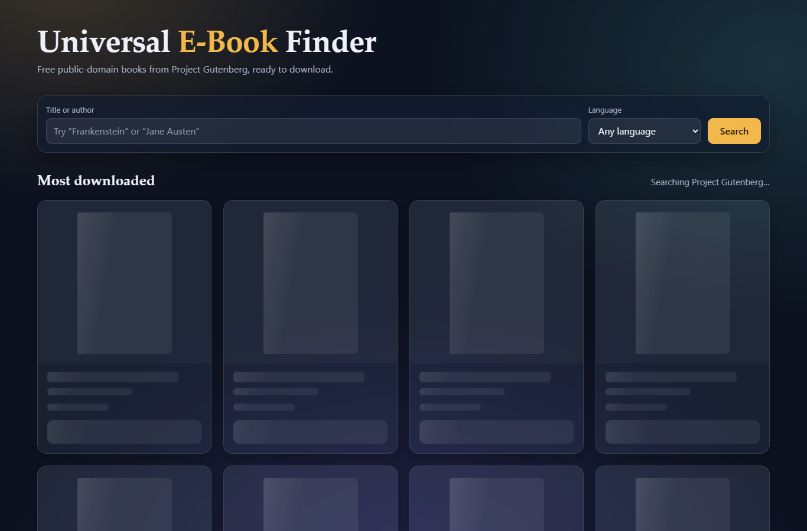
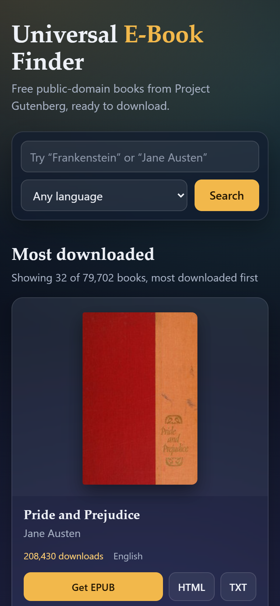

# Universal E-Book Finder

A responsive single-page app for finding free, public-domain e-books. Search Project Gutenberg's catalogue by title or author, filter by language, and download a book, with cover art and author biographies alongside the results.

It is written in plain HTML, CSS and JavaScript, with no frameworks, dependencies or build step.


## Features

- **Search and language filter** across the Project Gutenberg catalogue, most downloaded first
- **Direct downloads**, with the best available format highlighted (EPUB, then HTML, then TXT)
- **Cover art** from Open Library, falling back to Project Gutenberg artwork, then a generated CSS cover
- **Author biographies** from Wikipedia, checked against the author's birth and death years so namesakes aren't mixed up
- **Loading skeletons and progress messages**, which matter because the catalogue API can be slow
- **Specific error messages** for each service, with retry where it helps
- **Responsive dark, glass-style layout**, with keyboard support and reduced-motion handling

## Screenshots

### Author biography

"About the author" opens a Wikipedia summary over the card, so the grid stays in place.


### Loading state

Skeleton cards hold the layout while the catalogue responds.



### Mobile



## Getting started

No installation is needed. Clone the repository and open `index.html` in a modern browser:

```sh
git clone https://github.com/SikirullahO/universal-ebook-finder.git
cd universal-ebook-finder
```

The page runs directly from the file system, or from any static host such as GitHub Pages. It needs an internet connection, because all book data comes from the public APIs below.

## How it works

| Service | Used for | Called |
| --- | --- | --- |
| [Gutendex](https://gutendex.com/) | Book search, metadata and download links | On each search or "Load more" |
| [Open Library](https://openlibrary.org/developers/api) | Cover lookup by title and author | As each card nears the viewport, three at a time |
| [Wikipedia REST API](https://en.wikipedia.org/api/rest_v1/) | Author biography summaries | When "About the author" is opened |

None of these services needs an API key. A failure in Open Library or Wikipedia affects only covers or biographies; the search results stay usable.

## Project structure

```
index.html    Page structure and card templates
styles.css    Theme, layout, skeletons and responsive rules
app.js        API calls, error handling and rendering
screenshots/  Images used in this README
```

## Known limitations

- **Slow first results:** Gutendex can take close to a minute to respond. The app waits up to 60 seconds, retries once, and remembers results until the page is reloaded.
- **Cover matches:** covers are found by title and author, so one may show a different edition from the Gutenberg text.
- **English biographies only:** biographies come from English Wikipedia, whatever the book's language.

## Credits

Books and metadata come from [Project Gutenberg](https://www.gutenberg.org/) through Gutendex, covers from [Open Library](https://openlibrary.org/), and biographies from [Wikipedia](https://www.wikipedia.org/) under CC BY-SA.

## License

Released under the [MIT License](LICENSE). This covers the code in this repository, not the books, covers or biographies served by the APIs above, including the cover art visible in the screenshots.
